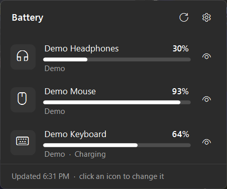

# Battery Bar

Shows the battery level of your wireless headphones, mouse and keyboard right on the Windows taskbar, next to the tray icons.




**[Download BatteryBar.exe](https://github.com/cappucinudev/battery-bar/releases/latest/download/BatteryBar.exe)** · [Install page](https://cappucinudev.github.io/battery-bar/)

- Tiny: one small (~240 KB) exe, no admin rights, no internet, no background services.
- Finds devices on its own. Nothing to set up.
- Hides with the taskbar (full-screen games stay clean). Follows light/dark mode and display scaling.
- Click the numbers for a Windows 11 style panel: every device with a battery bar and charging state, show/hide each one, click its icon to change it, and a settings page (check interval, text size, position, start with Windows).

## Install

1. Download `BatteryBar.exe` from the [latest release](https://github.com/cappucinudev/battery-bar/releases/latest).
2. Run it. If Windows SmartScreen says "Windows protected your PC", click **More info → Run anyway** (the exe is not code-signed).
3. Click **Yes** to install. It copies itself to `%LOCALAPPDATA%\Programs\BatteryBar`, starts with Windows and adds a Start menu entry.
   Click **No** to just run it once without installing.

Click the numbers on the taskbar (or open Battery Bar from the Start menu) to open the panel. The gear opens settings. Right-click the numbers for Refresh / Exit.

## Supported devices

| Brand / type | How it reads the battery |
| --- | --- |
| Logitech (G HUB running) | G HUB's local connection: every G HUB device with a battery (mice, keyboards, headsets) |
| Logitech (no G HUB) | Directly over HID++ 2.0: Lightspeed and Unifying receivers, Bolt, USB and Bluetooth mice and keyboards |
| Razer mice and keyboards | Directly over Razer's USB protocol (Synapse not needed) |
| Razer HyperSpeed headsets | BlackShark V2 Pro and others using the same dongle protocol |
| SteelSeries headsets (dongle) | Arctis 7 / 7P / 7X / 9 / Pro (2019), Arctis Nova 7 family, Nova Pro Wireless |
| HyperX headsets (dongle) | Cloud Flight, Cloud Alpha Wireless, Cloud II Wireless |
| Any other dongle that reports battery the standard HID way | Read automatically (HID Battery Strength / Battery System usages) |
| Any Bluetooth device | Whatever Windows shows in Settings → Bluetooth & devices (headphones, earbuds, mice, keyboards, controllers) |

Not shown? Open the panel → gear → **Copy diagnostics** and paste it into an [issue](https://github.com/cappucinudev/battery-bar/issues).
The diagnostics list every connected USB receiver/dongle with its IDs, so a missing one can be added. Corsair and SteelSeries mice are not supported yet.

Devices that nap (most mice sleep after a few idle minutes) keep their last value for 30 minutes.

## Uninstall

Panel → gear → **Uninstall**. It removes the startup entry, the Start menu entry, its settings and the installed exe.

## Build it yourself

Needs only Windows (uses the C# compiler that ships with .NET Framework 4.x):

```powershell
.\build.ps1        # -> dist\BatteryBar.exe
```

Useful switches: `BatteryBar.exe --portable` (run without the install prompt), `--demo` (fake devices), `--demo-settings` (open the panel on its settings page), `--dump out.txt` (write what each source sees and quit).

## How it works

- `src/Sources.cs` – battery sources (G HUB websocket, Logitech HID++, Razer HID, Windows device properties).
- `src/Bar.cs` – a transparent child window inside `Shell_TrayWnd`, placed left of the tray, drawn with per-pixel alpha.
- `src/App.cs` – startup, install/uninstall, polling, settings file (`%APPDATA%\BatteryBar\settings.txt`).
- `src/Flyout.cs` – the panel that opens above the taskbar (devices + settings).

## License

MIT
